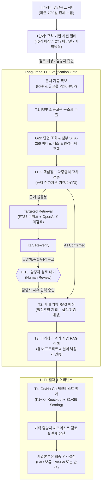

# 공공 SI 입찰 검토 시스템: 지능형 자동화(IA) 종합 QA 및 전문가 피드백 보고서

- **작성일:** 2026-11-18 (기말 프로젝트 13주차)
- **분석 대상:** `team_hw_05` 전체 코드베이스 및 마일스톤 구현물 (M1~M31)
- **도메인:** 공공 SI 수주 제안(Opportunity-to-Bid) 및 사전 적격성 심사 자동화

---

## 1. 프로젝트 종합 이해 및 아키텍처 분석

### 1.1 비즈니스 문제 정의 및 자동화의 본질
공공 SI 입찰 검토 업무는 나라장터에 공고가 게시된 후 수십~수백 페이지에 달하는 제안요청서(RFP)와 공고문을 분석하여 입찰 참여(Go / No-Go) 여부를 결정하는 프리세일즈 핵심 프로세스입니다.

- **단순 룰 기반 RPA의 한계**: 비정형 문서(표, 서식, 조항, 다단 레이아웃 등)에서 핵심 정보(금액, 자격, 일정, 기술 요구사항)를 정형 데이터로 추출할 수 없음.
- **단순 생성형 AI(LLM)의 위험성**: "통합정보시스템 3억 사업을 10억 이상으로 오인"하거나 "의료 CDW 금액 누락"과 같은 할루시네이션 발생 시, 수십~수백억 원 규모의 공공 사업에서 부정당업자 제재, 계약 해지, 입찰보증금 국고 귀속 등 치명적 사고로 이어짐.
- **지능형 자동화(Intelligent Automation)의 해결책**: 규칙 기반 사전 필터링 + LLM 정형 추출(T1) + 원문 증거 기반 교차검증 게이트(T1.5) + 사내 역량/시장 RAG 매칭(T2, T3) + 종합 리포트 및 체크리스트(T4) + 사람 중심 결재 거버넌스(HITL)를 결합한 다층 방어 체계 구축.

### 1.2 엔드투엔드 파이프라인 아키텍처



---

## 2. 전문가 관점에서 본 우수한 설계 및 차별점 (Best Practices)

1. **Evidence-First 원칙 기반 T1.5 Verification Gate (`verification.py`)**
   - `Confirmed`, `Retrieve More`, `Conflict`, `Human Review`의 4단 상태 머신을 설계.
   - 청크 ID, 문서명, 페이지 번호, 조항명, 원문 인용(Quote)이 없는 추출 정보는 후속 분석(T2, T3)으로 전파되지 못하도록 엄격히 통제.
2. **다중 출처 교차검증 및 바이트 레벨 무결성 검증 (`notices.py`)**
   - 로컬 저장 PDF와 조달청 실시간 API 첨부파일의 SHA-256 해시를 비교(`compare_notice_pdf_bytes`)하여 판본 변경 및 변조 감지.
   - 나라장터 용역변경이력(`getBidPblancListInfoChgHstryServc02`)을 연동하여 정정공고 발생 시 자동으로 `Human Review`로 전환.
3. **순수 표준 라이브러리 기반 HWP 5.0 / HWPX 자체 파서 (`hwp_text.py`)**
   - 외부 라이브러리 종속성 없이 `struct`, `zlib`, `zipfile`, `xml.etree`만으로 OLE 복합 문서, HWP 태그 67(문단 텍스트), 서로게이트 쌍 복원, HWPX DTD 엔티티 확장 공격(XXE) 방어 및 압축 해제 용량 제한(Zip Bomb 방어)을 구현.
   - 공공 제안요청서의 80% 이상이 HWP라는 현실적 장벽을 정면으로 해결.
4. **판단 기준 스냅샷(Criteria Snapshot)과 불변성 거버넌스**
   - 본부장이 기준 세트를 변경하더라도 이미 진행된 검토 건은 당시의 `criteria.json` 스냅샷을 보존하여 과거 판정의 일관성 유지.
   - 결재 이력(`workflow.json`)과 핵심정보 검토 이력(`core_review_audit.json`)을 Append-only 형태로 영구 기록.
5. **실데이터 기반 정량적 튜닝 및 노이즈 제거 (M22, M25, M26)**
   - 보안서약서, 지재권 귀속 등 제안서 행정 조항을 T2 회사 역량 매칭에서 정규식으로 제외하여 검색 노이즈 9건 제거.
   - 키워드 수집의 59% 누락률을 실측하여 전체 수집 + 규칙 필터 방식으로 성공적 피벗.

---

## 3. 심층 QA: 결함(Defects) 및 보완해야 할 점

### ⚠️ [CRITICAL] 1. T1.5 검증 결과와 Go/No-Go 체크리스트(K1~K4) 간의 데이터 단절
- **문제점**:
  - `src/bid_review/checklist.py`의 `evaluate()` 함수는 `report`, `rfp`, `capability`, `checklist`, `awards`만 인자로 받음.
  - M1~M31을 통해 구축한 **T1.5의 핵심 결과(`CoreInfoVerification` / `langgraph_review.json`)가 체크리스트 평가 함수에 전달되지 않음**.
  - 이로 인해 `K2`(사업규모 적정성)와 `K3`(공동수급 및 지역조건)는 항상 `UNKNOWN`("확인 필요")으로 하드코딩됨:
    ```python
    "K2": (UNKNOWN, _scale_note(scale.get("amount_krw")), scale.get("source_page")),
    "K3": (UNKNOWN, "공동수급·지역 조건은 공고문 원문으로 확인", None),
    ```
- **영향**:
  - T1.5에서 나라장터 API(`cmmnSpldmdMethdNm`)와 공고문 PDF를 통해 공동수급 불허 일치(`confirmed`)를 확인했더라도, 체크리스트 상에서는 K3가 여전히 "확인 필요"로 남아 종합 권고가 "보류"로 떨어지며 담당자가 수기로 고쳐야 함.
- **개선안**:
  - `checklist.evaluate()`에 `core_review`(또는 `verification`) 객체를 인자로 전달.
  - T1.5에서 `g2b_joint_contract` 및 `g2b_license_limit`가 `confirmed`된 경우 K1/K3를 자동으로 "충족"으로 초기 판정하도록 연결.

---

### ⚠️ [ARCHITECTURAL] 2. 실행 파이프라인의 이원화 (CrewAI vs LangGraph) 및 상태 불일치
- **문제점**:
  - 웹에서 공고 검토를 시작하면 백엔드 `JobManager`는 하위 프로세스로 `run.py` (기존 CrewAI 파이프라인)를 실행함.
  - 이때 Agent 1 → 2/3 → 4가 먼저 실행되어 `report.json`을 완성해 버림.
  - 이후 웹 화면의 `CoreReviewTab`에서 "검증 실행"을 누르거나 결재를 올리려 할 때 비로소 LangGraph 파이프라인(`POST /api/runs/{run_id}/core-review`)이 사후 실행됨.
- **영향**:
  - "검증되지 않은 T1 데이터는 절대 T2/T3/T4로 흘려보내지 않는다"는 T1.5 게이트의 본래 설계 철학과 달리, 초기 실행 시 비검증 T1 데이터로 이미 전체 보고서가 작성됨.
  - LangGraph에서 담당자 승인 후 재실행된 `t2_company_match` 결과가 `langgraph_review.json`에만 기록되고, 기존 `report.json`의 종합 점수나 AI 권고문에는 동기화되지 않음.
- **개선안**:
  - 메인 파이프라인을 LangGraph 워크플로우(`src/bid_review/rag/workflow.py`) 기반으로 단일화하고, T1.5 통과(또는 승인) 후에만 T2, T3, T4 보고서 작성이 트리거되도록 일원화.

---

### ⚠️ [FUNCTIONAL] 3. 공고문(Notice)의 HWP 형식 미지원
- **문제점**:
  - M31에서 제안요청서(RFP)는 HWP/HWPX 파서를 구현했으나, **공고문(Notice)**은 여전히 PDF만 처리하도록 하드코딩되어 있음.
  - `src/bid_review/web/notices.py` 라인 238:
    ```python
    if not content.startswith(b"%PDF-"):
        return {"status": "download_not_pdf", "local_sha256": local_sha256, ...}
    ```
- **영향**:
  - 공공기관(기초지자체, 교육기관 등)이 공고문을 `공고문.hwp`로 등록한 경우, 바이트 대조가 `download_not_pdf`로 실패하고 공고문 RAG 색인에서 누락되어 교차검증의 완전성이 저하됨.
- **개선안**:
  - `hwp_text.py` 파서를 공고문 첨부파일(`notice.hwp`, `notice.hwpx`)에도 적용하여 텍스트를 추출하고, 해시 대조 역시 HWP 바이너리를 허용하도록 확장.

---

### ⚠️ [RAG & AI] 4. 한국어 공공 계약 도메인 특화 임베딩 및 Re-ranker 부재
- **문제점**:
  - 의미 검색(Dense Retrieval)에 범용 소형 모델인 OpenAI `text-embedding-3-small`을 사용.
  - 팀 내부 M25 평가에서도 *"0.35~0.55 구간 어디서나 정밀도 약 0.42로 점수가 관련성을 가르지 못함"*, *"점수 구분력이 약함"*이라고 자체 진단함.
- **영향**:
  - 공공 조달 문서는 "추정가격", "배정예산", "부가가치세 별도", "공동이행", "소프트웨어사업자" 등 조달 전문 용어가 핵심인데, 범용 소형 임베딩 모델로는 미세한 조건 차이를 변별하기 어려움.
- **개선안**:
  - **Cross-Encoder Re-ranker 도입**: 1차 FTS5 + Dense 검색 결과 상위 후보군에 대해 Re-ranker(예: `bge-reranker-large` 또는 LLM Re-ranker)를 적용하여 정밀도(Precision)를 극대화.
  - 한국어 공공/금융 도메인 적합 임베딩 모델(KoE5, Solar Embedding 등) 검토.

---

### ⚠️ [SECURITY & CONCURRENCY] 5. 파일 기반 동시성 락 및 인증 체계의 실무적 한계
- **문제점**:
  - 백엔드 락: `runs.py`의 `_workflow_lock = threading.Lock()`이 전역(Global) 단일 락으로 작동하며, `JobManager`도 프로세스 레벨 단일 슬롯(`BUSY` 409).
  - 역할 제어: HTTP 헤더 `X-Role: staff` / `director`에만 의존하여 클라이언트 측에서 손쉽게 역할 변조 가능.
- **영향**:
  - 다중 사용자가 동시 접속하여 공고를 검토하고 결재를 처리하는 엔터프라이즈 환경에서 병목 및 파일 쓰기 충돌 위험 발생.
- **개선안**:
  - 단일 사용자 실습을 넘어 프로덕션으로 갈 경우 SQLite WAL 모드 또는 PostgreSQL 기반 트랜잭션 처리와, 사내 SSO(OAuth2/OIDC) 기반의 JWT 인증 체계 도입 필요.

---

## 4. 단계별 권장 로드맵 (Action Items)

| 구분 | 과제 | 중요도 | 기대 효과 |
|---|---|:---:|---|
| **즉시 보완 (13주차 발표 전)** | **T1.5 검증 결과를 Checklist 초기값에 연동**<br/>- `runs.py`의 `_checklist()` 호출 시 `core_review`를 주입하여 K1, K2, K3 자동 반영 | 🔴 최우선 | 발표 시연에서 "T1.5 검증 결과가 체크리스트 판정 및 본부장 의사결정까지 완벽히 이어지는 엔드투엔드 연결성" 증명 가능 |
| **즉시 보완 (13주차 발표 전)** | **공고문(Notice) HWP 파일 허용**<br/>- `notices.py`의 `compare_notice_pdf_bytes`에서 HWP 바이너리 허용 및 `hwp_text` 파싱 연동 | 🟡 높음 | HWP 공고문을 가진 공고 건에서도 교차검증 게이트가 정상 동작 |
| **기말 고도화 (최종 제출)** | **LangGraph 파이프라인 일원화**<br/>- CrewAI와 LangGraph의 이원화 구조를 LangGraph 단일 워크플로우로 통합 | 🟡 높음 | 아키텍처 단순화, 실행 속도 개선, 상태 동기화 오류 원천 차단 |
| **기말 고도화 (최종 제출)** | **Re-ranker 도입**<br/>- M25에서 확인된 의미 검색 구분력 한계를 Cross-Encoder Re-ranker로 극복 | 🟢 보통 | RAG 검색 정밀도 대폭 향상 (0.42 → 0.80 이상) |
| **프로덕션 확장** | **RBAC 인증 및 DB 트랜잭션**<br/>- 사내 SSO 연동, 파일 기반 JSON 저장소를 RDBMS로 전환 | ⚪ 향후 | 다중 사용자 엔터프라이즈 서비스 준비 완료 |

---

## 5. 총평

본 프로젝트는 단순한 과제 수준을 뛰어넘어 **실제 엔터프라이즈 IT 서비스 기업(아이티센 등)의 프리세일즈 업무에 즉시 투입 가능한 수준의 완성도 높은 지능형 자동화(IA) 구조**를 갖추고 있습니다. 

특히 **M31까지 단계별로 축적한 정밀한 마일스톤 관리, 순수 표준 라이브러리 HWP 파서 구현, SHA-256 해시 기반 판본 변조 감지, 행정 조항 필터링** 등은 심사위원 및 평가자에게 대단히 강한 인상을 줄 수 있는 강력한 차별점입니다. 위 피드백 중 **"T1.5 검증 결과와 체크리스트 자동 판정 간의 연결"**만 보완하면 결점 없는 완벽한 프로젝트가 될 것입니다.
